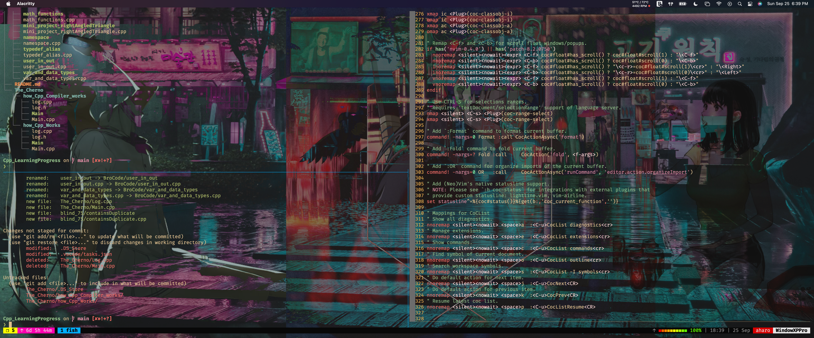

# Alacritty

My Alacritty configuration for macOS, with a translucent window, Fish login shell, Catppuccin Macchiato and tmux/Neovim keybindings.



```sh
git clone git@github.com:aharoJ/alacritty.git ~/.config/alacritty
alacritty
```

Alacritty reads `~/.config/alacritty/alacritty.toml`; its theme imports use that directory. Install FiraCode Nerd Font and AnonymicePro Nerd Font separately, as the current font settings request them. The bundled Hack, Lekton and ComicShannsMono font files retain their full upstream license and copyright metadata. FiraCode, DaddyTimeMono and Monofur binaries remain private because the source copies lack their required companion/full license notices. No font bytes were modified.

`themes/` also contains the other Catppuccin palettes, Kanagawa Wave and the older gruvbox-material YAML palette. `backup/` keeps the original saved configurations. Older YAML schemas, font names and imports may require their original Alacritty versions and dependencies.

Annotated tags preserve these configurations, oldest first. The current setup is main and `v0.12.0`. A `without` list records the source files omitted from that public snapshot.

- `v0.1.0` — Original public gruvbox YAML (2023-01-27).
- `v0.2.0` — old_dotfiles SFMono YAML (2023-07-31).
- `v0.3.0` — Saved SFMono YAML configuration (2023-08-27).
- `v0.4.0` — Saved YAML keybinding reference (2024-03-09).
- `v0.5.0` — Last active YAML generation (2024-04-22).
- `v0.6.0` — Saved YAML version 0.0.1 (2024-04-22).
- `v0.7.0` — Saved YAML version 0.0.2 (2024-04-22).
- `v0.8.0` — Saved YAML version 0.0.3 (2024-04-22).
- `v0.9.0` — Saved TOML reference (2024-04-22).
- `v0.10.0` — Saved TOML version 0.0.1 (2024-04-22).
- `v0.11.0` — TOML before the general section (2024-12-05). Without fonts/DaddyTimeMonoNerdFont-Regular.ttf, fonts/FiraCodeNerdFont-Bold.ttf, fonts/FiraCodeNerdFont-Light.ttf, fonts/FiraCodeNerdFont-Medium.ttf, fonts/FiraCodeNerdFont-Regular.ttf, fonts/FiraCodeNerdFont-Retina.ttf, fonts/FiraCodeNerdFont-SemiBold.ttf, fonts/MonofurNerdFont-Bold.ttf, fonts/MonofurNerdFont-Italic.ttf, fonts/MonofurNerdFont-Regular.ttf, scripts/toggle_blur.py.
- `v0.12.0` — Current general-section TOML (2026-10-18). Without .DS_Store, fonts/.DS_Store, fonts/DaddyTimeMonoNerdFont-Regular.ttf, fonts/FiraCodeNerdFont-Bold.ttf, fonts/FiraCodeNerdFont-Light.ttf, fonts/FiraCodeNerdFont-Medium.ttf, fonts/FiraCodeNerdFont-Regular.ttf, fonts/FiraCodeNerdFont-Retina.ttf, fonts/FiraCodeNerdFont-SemiBold.ttf, fonts/MonofurNerdFont-Bold.ttf, fonts/MonofurNerdFont-Italic.ttf, fonts/MonofurNerdFont-Regular.ttf, themes/.DS_Store, themes/catppuccin/.DS_Store.

The configuration keeps its original 2023 MIT license. Bundled fonts retain their own licenses: Hack uses MIT and Bitstream Vera, Lekton uses SIL OFL 1.1, and ComicShannsMono uses MIT.

[Catppuccin](https://github.com/catppuccin/alacritty), [Kanagawa](https://github.com/rebelot/kanagawa.nvim) and [gruvbox-material](https://github.com/sainnhe/gruvbox-material) are upstream theme projects.

<details>
<summary>Catppuccin license notice</summary>

```text
MIT License

Copyright (c) 2021 Catppuccin

Permission is hereby granted, free of charge, to any person obtaining a copy
of this software and associated documentation files (the "Software"), to deal
in the Software without restriction, including without limitation the rights
to use, copy, modify, merge, publish, distribute, sublicense, and/or sell
copies of the Software, and to permit persons to whom the Software is
furnished to do so, subject to the following conditions:

The above copyright notice and this permission notice shall be included in all
copies or substantial portions of the Software.

THE SOFTWARE IS PROVIDED "AS IS", WITHOUT WARRANTY OF ANY KIND, EXPRESS OR
IMPLIED, INCLUDING BUT NOT LIMITED TO THE WARRANTIES OF MERCHANTABILITY,
FITNESS FOR A PARTICULAR PURPOSE AND NONINFRINGEMENT. IN NO EVENT SHALL THE
AUTHORS OR COPYRIGHT HOLDERS BE LIABLE FOR ANY CLAIM, DAMAGES OR OTHER
LIABILITY, WHETHER IN AN ACTION OF CONTRACT, TORT OR OTHERWISE, ARISING FROM,
OUT OF OR IN CONNECTION WITH THE SOFTWARE OR THE USE OR OTHER DEALINGS IN THE
SOFTWARE.
```

</details>
